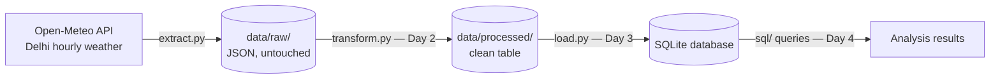

# Open-Data ETL Pipeline — Delhi Weather


-003B57?style=flat&logo=sqlite&logoColor=white)


A small data engineering project that extracts open weather data from a public API, cleans and validates it, loads it into a database, and analyses it with SQL — built step by step, with each stage kept separate and testable.

## Pipeline Architecture



**Design principle:** the raw layer is never edited. Every downstream stage can be rebuilt from `data/raw/` at any time.

## Data Source
- **Open-Meteo API** — https://open-meteo.com — free & open, no API key required
- **Location:** Delhi, India (28.6139, 77.2090) · Timezone: Asia/Kolkata
- **Fields:** `temperature_2m`, `relative_humidity_2m`, `precipitation`, `wind_speed_10m` (hourly, 7-day forecast = 168 records per extract)

## Quick Start

```bash
git clone https://github.com/dxhanjay/open-data-etl-pipeline.git
cd open-data-etl-pipeline
python extract.py
```

No dependencies to install — the extractor uses only the Python standard library.

**Sample output:**
```
Downloading: https://api.open-meteo.com/v1/forecast?latitude=28.6139&longitude=77.209&...
Saved raw file : data/raw/delhi_weather_raw_2026-10-31.json
Hourly records : 168
Fields         : time, temperature_2m, relative_humidity_2m, precipitation, wind_speed_10m
Extract complete. Next step (Day 2): transform.py — clean & validate.
```

## Project Structure

```
open-data-etl-pipeline/
├── extract.py            # Day 1 — download raw data from the API
├── transform.py          # Day 2 — clean + data quality checks (next)
├── load.py               # Day 3 — load into SQLite (planned)
├── sql/                  # Day 4 — SQL analysis queries (planned)
├── data/
│   ├── raw/              # raw API responses, untouched (git-ignored, regenerated by extract.py)
│   └── processed/        # cleaned output
├── README.md
├── LICENSE
└── .gitignore
```

## Build Roadmap

- [x] **Day 1 — Extract:** API → `data/raw/` as untouched JSON, with record count logged
- [ ] **Day 2 — Transform:** parse JSON into a tidy table; handle missing values; quality checks (no null timestamps, no duplicate hours, sane value ranges)
- [ ] **Day 3 — Load:** SQLite schema design + loader script (idempotent re-runs)
- [ ] **Day 4 — Analyse:** 8–10 SQL queries — daily averages, hottest hour of the week, rainy hours, wind patterns
- [ ] **Day 5 — Polish:** results write-up, final documentation, project summary

## Skills Demonstrated
*Listed only as the corresponding stage is completed.*

- **Day 1:** Python (REST APIs, JSON, file handling), ETL design, raw-layer data modelling

## Author
**Dhananjoy Mahato** — Final-year BTech CSE, GD Goenka University, Gurugram
LinkedIn: https://www.linkedin.com/in/dhananjoy-mahato-303462272 · GitHub: https://github.com/dxhanjay

## License
MIT — see [LICENSE](LICENSE).
