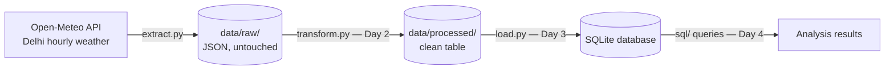

# Open-Data ETL Pipeline — Delhi Weather


A small data engineering project that extracts open weather data from a public API, cleans and validates it, loads it into a database, and analyses it with SQL — built step by step, with each stage kept separate and testable.

## Pipeline Architecture



**Design principle:** the raw layer is never edited. Every downstream stage can be rebuilt from `data/raw/` at any time.

## Data Source
- **Open-Meteo API** — https://open-meteo.com — free & open, no API key required
- **Location:** Delhi, India (28.6139, 77.2090) · Timezone: Asia/Kolkata
- **Fields:** `temperature_2m`, `relative_humidity_2m`, `precipitation`, `wind_speed_10m` (hourly, 7-day forecast = 168 records per extract)

## Quick Start

```bash
git clone https://github.com/dxhanjay/open-data-etl-pipeline.git
cd open-data-etl-pipeline
python extract.py                       # Day 1 — stdlib only, nothing to install
pip install -r requirements.txt         # pandas, needed from Day 2 on
python transform.py                     # Day 2 — clean + quality checks
python load.py                          # Day 3 — load into SQLite (stdlib only)
```

**Sample output — extract:**
```
Downloading: https://api.open-meteo.com/v1/forecast?latitude=28.6139&longitude=77.209&...
Saved raw file : data/raw/delhi_weather_raw_2026-10-31.json
Hourly records : 168
Fields         : time, temperature_2m, relative_humidity_2m, precipitation, wind_speed_10m
```

**Sample output — transform:**
```
Raw file      : delhi_weather_raw_2026-10-31.json
Rows in       : 168
Rows out      : 168
Duplicates    : 0 removed
Hourly gaps   : 0 filled
Dropped rows  : 0 (missing temperature)
Missing values: {'timestamp': 0, 'temperature_c': 0, 'humidity_pct': 0, 'precipitation_mm': 0, 'wind_speed_kmh': 0}
Range issues  : {'humidity_out_of_range': 0, 'negative_precipitation': 0, 'negative_wind_speed': 0, 'temperature_out_of_band': 0}
Clean CSV     : data/processed/delhi_weather_clean.csv (168 rows)
Quality checks: all value ranges OK.
```

**Cleaning rules (explicit, never silent):** readable column names with units; timestamps parsed and sorted; duplicate hours dropped; missing hours re-indexed onto a full hourly grid and counted; rows without a temperature dropped; value ranges validated every run (humidity 0–100 %, no negative precipitation/wind, temperature sanity band −10…55 °C) with a non-zero exit code if any violation is found.

**Sample output — load:**
```
Clean CSV rows : 168
Table before   : 0 rows
Table after    : 168 rows (+168 net new)
Coverage       : 2026-10-31 00:00:00  →  2026-11-06 23:00:00
Database       : data/delhi_weather.db
Load complete — safe to re-run, timestamps upsert by key.
```

**Load design:** schema in `sql/schema.sql` — one row per hour, `timestamp` as PRIMARY KEY, CHECK constraints mirroring the Day 2 quality rules, plus an index on the date for analysis queries. `load.py` upserts with `INSERT OR REPLACE` inside a single transaction, so re-running the pipeline updates existing hours and appends new ones without ever duplicating rows (verified: second run = +0 net new).

## Project Structure

```
open-data-etl-pipeline/
├── extract.py            # Day 1 — download raw data from the API
├── transform.py          # Day 2 — clean + data quality checks
├── load.py               # Day 3 — load clean CSV into SQLite (idempotent upsert)
├── sql/
│   ├── schema.sql        # Day 3 — weather_hourly table + date index
│   └── ...               # Day 4 — SQL analysis queries (planned)
├── requirements.txt      # pandas (Day 2 onward)
├── data/
│   ├── raw/              # raw API responses, untouched (git-ignored, regenerated by extract.py)
│   └── processed/        # cleaned CSV output (git-ignored, regenerated by transform.py)
├── README.md
├── LICENSE
└── .gitignore
```

## Build Roadmap

- [x] **Day 1 — Extract:** API → `data/raw/` as untouched JSON, with record count logged
- [x] **Day 2 — Transform:** parse JSON into a tidy table with pandas; duplicate/gap/missing-value handling; quality checks on timestamps and value ranges, reported every run
- [x] **Day 3 — Load:** SQLite schema (timestamp primary key, CHECK constraints, date index) + loader with `INSERT OR REPLACE` upserts — re-runs verified duplicate-free
- [ ] **Day 4 — Analyse:** 8–10 SQL queries — daily averages, hottest hour of the week, rainy hours, wind patterns
- [ ] **Day 5 — Polish:** results write-up, final documentation, project summary

## Skills Demonstrated
*Listed only as the corresponding stage is completed.*

- **Day 1:** Python (REST APIs, JSON, file handling), ETL design, raw-layer data modelling
- **Day 2:** pandas (tidy tables, datetime handling, deduplication, reindexing), data cleaning, data quality checks
- **Day 3:** SQL DDL (tables, primary keys, CHECK constraints, indexes), SQLite, idempotent loads / upserts, transactional writes

## Author
**Dhananjoy Mahato** — Final-year BTech CSE, GD Goenka University, Gurugram
LinkedIn: https://www.linkedin.com/in/dhananjoy-mahato-303462272 · GitHub: https://github.com/dxhanjay

## License
MIT — see [LICENSE](LICENSE).
